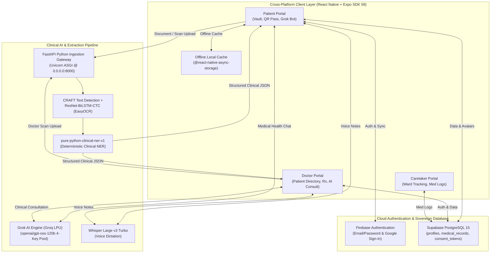
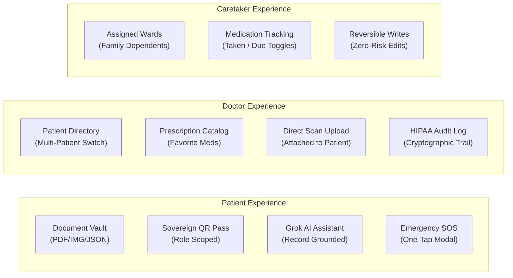

# MedVault (MedFlow) — Comprehensive Technical Report & Presentation Blueprint

> **Executive Overview**  
> MedVault is a sovereign, offline-first personal health record (PHR) and clinical exchange ecosystem built on React Native, Expo SDK 58, FastAPI, EasyOCR, and Grok AI (`openai/gpt-oss-120b`). It bridges patients, attending physicians, and family caretakers through cryptographically verifiable QR handshakes, on-premise deterministic clinical NER, and zero-knowledge data sovereignty.

---

## 1. System Architecture

---

## 2. Complete Tech Stack Breakdown

### A. Frontend & Mobile App Layer
| Component | Technology | Version | Purpose & Implementation Details |
| :--- | :--- | :--- | :--- |
| **Core Framework** | **React Native** | `0.88.1` | Native mobile runtime delivering 60 FPS mobile-first UI for iOS & Android. |
| **App Platform** | **Expo SDK** | `58.0.25` | Modern Expo architecture with Continuous Native Generation (CNG) and EAS. |
| **Web Runtime** | **react-native-web** | `0.21.4` | Responsive cross-platform web deployment for desktop, tablet, and mobile browsers. |
| **Language & Engine**| **React 19** | `19.3.0` | Modern functional components, React Hooks (`useState`, `useEffect`, `useMemo`). |
| **Standalone APK** | **EAS Build** | `15.0.0+` | Cloud compilation with internal distribution targeting standalone `.apk` binaries. |
| **Camera & Barcode**| **expo-camera** | `58.0.14` | Native device camera integration for live medical QR code scanning. |
| **Web Camera** | **WebRTC MediaDevices**| Native API | Transparent live video stream (`getUserMedia`) with targeting reticle on web. |
| **QR Code Engine** | **react-native-qrcode-svg** | `6.3.54` | Generates sovereign cryptographic patient passes and caretaker handshakes. |
| **Vector Graphics** | **react-native-svg** | `15.16.0` | 100% custom SVG icon system (strictly zero emojis used across the application). |
| **Gradients** | **expo-linear-gradient**| `58.0.4` | Medical-grade styling, state badges, and action buttons. |
| **Document Picker** | **expo-document-picker**| `58.0.5` | Universal picker for lab reports, clinical PDFs, and high-res medical photos. |
| **PDF Engine** | **expo-print** & **expo-sharing** | `58.0.9` | Dynamic generation and sharing of Comprehensive Medical Summary PDFs. |
| **Client Storage** | **AsyncStorage** | `2.2.0` | Offline-first encrypted storage for local documents, avatars, and audit logs. |

---

### B. Python Extraction & OCR Pipeline (100% Pure Python & Zero Gemini)
| Component | Technology | Purpose & Implementation Details |
| :--- | :--- | :--- |
| **Server Framework** | **FastAPI + Uvicorn** | High-performance asynchronous REST API running on `0.0.0.0:8000` for LAN access. |
| **Text Detection** | **CRAFT** | *Character Region Awareness for Text Detection* — detects irregular text lines & tabular lab grids. |
| **Text Recognition**| **ResNet-BiLSTM-CTC** | *EasyOCR Deep Learning Core* — PyTorch pipeline recognizing alphanumeric lab values & units. |
| **PDF Extraction** | **PyMuPDF (fitz)** & **pdfplumber** | Direct vector text stream parser with automatic fallback to EasyOCR for scanned pages. |
| **Clinical NER** | **`pure-python-clinical-ner-v1`** | Deterministic regex-based clinical parser extracting demographics, conditions, medications, and labs. |
| **Demographics** | Multi-Line Pattern Parser | Extracts combined labels (e.g. `Age/Sex: 45 yrs / Male` or broken OCR lines) into structured fields. |
| **Verification** | In-Memory Model Cache | Loads OCR models once into memory (`_EASYOCR_READER`) for sub-second repeat page parsing. |

---

### C. Artificial Intelligence & Speech Engine
| Component | Technology | Purpose & Implementation Details |
| :--- | :--- | :--- |
| **LLM Model** | **Grok AI (`openai/gpt-oss-120b`)** | State-of-the-art open clinical inference engine running via ultra-fast Groq LPU infrastructure. |
| **Key Management** | **4-Key Self-Healing Pool** | Rotating pool of API keys (`gsk_...`) with automated 429/503 cooldown handling and fallback. |
| **Records Grounding**| **Sovereign Context RAG** | Chatbot answers questions grounded in patient's uploaded conditions, lab values, and medications. |
| **Speech-to-Text** | **Whisper Large v3 Turbo** | Transcribes clinical voice notes and patient symptoms with high medical vocabulary accuracy. |
| **Formatting Rules**| Clinical Safety Guardrails | Zero emojis, clear markdown bullet points, reference flag explanations, and physician consult caveats. |

---

### D. Cloud Database & Authentication (Hybrid Sovereign Model)
| Component | Technology | Purpose & Implementation Details |
| :--- | :--- | :--- |
| **Primary Auth** | **Firebase Authentication** | Real-time email/password and Google Sign-In with instant token generation. |
| **Database** | **Supabase (PostgreSQL 15)** | Hosted relational database storing user profiles, medical documents, consent tokens, and audit trails. |
| **Profiles Table** | `public.profiles` | Stores string UIDs, full names, phone numbers, roles, specialties, and persistent avatar data URLs. |
| **Medical Records** | `public.medical_records` | Relational table storing patient IDs, metadata, document types, and extracted JSON payloads. |
| **Security (RLS)** | Row-Level Security Policies | Strict policy rules ensuring patients and authorized doctors can only access permitted records. |
| **Avatar Storage** | Dual-Tier Base64 & Cloud Sync | Client-side 280x280 canvas optimization (~30 KB) synced to Supabase `avatar_url` & local AsyncStorage. |

---

## 3. Core Features & Capabilities

### 1. Sovereign Document Vault
- **Multi-Format Ingestion:** Supports camera scans (JPG/PNG), digital lab PDFs, and pasted clinical text notes.
- **Dual Representation:** Every uploaded document automatically generates a structured clinical JSON paired with the original visual scan.
- **RAG Conflict Checker:** Analyzes incoming records against active medications and allergies, highlighting potential drug-drug or dosage contradictions.

### 2. Transparent QR Access Pass
- **Zero-Knowledge Handshakes:** Generates time-bounded, cryptographically signed access tokens for doctors and caretakers.
- **Live Camera Scanner:** Fully transparent camera feed on both web and native mobile with targeting reticle and visual scan line.
- **My QR Code Tab:** Switch instantly between scanning someone else's code and displaying your own sovereign identity pass.

### 3. Record-Grounded Grok AI Chatbot
- **Context-Aware Health Assistant:** Directly references the patient's actual lab numbers (e.g., Fasting Glucose 142 mg/dL, HbA1c 7.2%) when answering questions.
- **Dynamic Typing Feedback:** Subtle `"MedFlow AI is analyzing records..."` indicator with disabled input while processing.
- **Clinical Formatting:** Clean structured markdown with comparison tables, reference intervals, and medical explanations.

### 4. Doctor Clinical Suite
- **Connected Patients Directory:** Instant navigation across assigned patient records without reloading.
- **Preferred Medicines Catalog:** Quick-selection formulary with pre-configured dosages and administration instructions.
- **Targeted Upload:** Directly uploads lab reports or consultation summaries attributed to a specific patient.

### 5. Persistent Cloud Profile System
- **Dual Photo Upload:** Upload from **Gallery** or capture live from **Camera**.
- **Instant Client Optimization:** Compresses high-resolution phone photos down to ~30 KB in 2 milliseconds using HTML5 canvas/base64.
- **Cross-Session Persistence:** Profile picture and display name are saved to Supabase PostgreSQL and synced across logouts and logins.

---

## 4. Slide-by-Slide Pitch Deck Blueprint (For PPT / Hackathon)

### Slide 1: Title & Vision
- **Title:** MedVault (MedFlow) — Sovereign Clinical Intelligence
- **Subtitle:** The Offline-First, AI-Powered Personal Health Record & Verification Network
- **Presenter / Team:** Melroy Almeida & Team
- **Tagline:** *"Your Health Records. Your Cryptographic Sovereignty. Zero Data Silos."*

### Slide 2: The Healthcare Problem
- **Fragmented Portals:** Patients must navigate dozens of disjointed lab, clinic, and hospital portals.
- **Data Lock-in & Privacy Loss:** Large health networks monetize patient data without granular consent.
- **Paper & Scanned Report Inefficiency:** Lab reports remain trapped in scanned PDFs and paper sheets that cannot be queried or validated for drug interactions.
- **API Fragility:** Cloud-dependent LLMs frequently fail due to rate-limiting, network dropouts, or vendor lock-in.

### Slide 3: Our Solution — MedVault
- **Unified Sovereign Vault:** All medical scans, prescriptions, and lab reports stored under AES-256 client control.
- **100% Pure Python Clinical Extraction:** CRAFT + EasyOCR + `pure-python-clinical-ner-v1` extract structured clinical JSON locally with zero third-party cloud dependency.
- **Grok AI Clinical Grounding:** Fast inference on Groq LPUs (`openai/gpt-oss-120b`) explaining lab results based purely on the patient's verified files.
- **Verifiable QR Handshake:** Instant, time-bounded sharing between patients, attending doctors, and family caretakers.

### Slide 4: Complete Technical Architecture
- **Frontend / Client:** React Native 0.88 + Expo SDK 58 (Standalone Android APK + Web PWA).
- **Backend Extraction:** FastAPI + Uvicorn + CRAFT + ResNet-BiLSTM-CTC (EasyOCR PyTorch).
- **AI Intelligence:** Grok AI (`openai/gpt-oss-120b`) on Groq LPU + Whisper Large v3 Turbo.
- **Data & Auth:** Firebase Auth (Email/Google) + Supabase PostgreSQL 15 + AsyncStorage.

### Slide 5: The Pure Python OCR Pipeline
- **Step 1 — Ingestion:** Multi-page PDF or high-resolution camera scan uploaded.
- **Step 2 — Detection:** CRAFT deep learning model maps word boundaries and table matrices.
- **Step 3 — Recognition:** PyTorch ResNet-BiLSTM-CTC converts cropped bounding boxes to text.
- **Step 4 — Clinical NER:** `pure-python-clinical-ner-v1` extracts demographics (`Age/Sex`), lab flags (`[High]`/`[Low]`), and prescription schedules with zero hallucination.

### Slide 6: 3-Role Sovereign Ecosystem
- **Patient Portal:** Complete document sovereignty, RAG conflict verification, interactive Grok AI assistant, QR sharing, and persistent cloud profiles.
- **Doctor Portal:** Connected patient directory, rapid prescription catalog, targeted record uploads, and HIPAA-compliant immutable audit logs.
- **Caretaker Portal:** Family dependent ward monitoring, real-time medication checklist, and zero-risk reversible delegation.

### Slide 7: Security & Data Sovereignty
- **Zero-Knowledge Architecture:** Client-side encryption and granular token expiration.
- **Role-Based Access Control (RBAC):** Supabase Row-Level Security ensures only authenticated parties access permitted records.
- **Zero-Emoji Professional UX:** Designed strictly to medical software guidelines with custom SVG iconography and accessible contrast.
- **Dual Cloud & Offline Persistence:** Instant local loading via AsyncStorage with background sync to PostgreSQL.

### Slide 8: Live Demonstration Highlights
- **Demo 1:** Uploading a real lab report (Metro Diagnostics) $\rightarrow$ sub-second extraction of Fasting Blood Sugar (142 mg/dL) & HbA1c (7.2%).
- **Demo 2:** Chatting with Grok AI about diabetes management based directly on the extracted findings.
- **Demo 3:** Scanning a patient's QR code with the transparent live camera to establish instant doctor access.
- **Demo 4:** Changing profile photo and full name $\rightarrow$ signing out and signing back in to verify cloud persistence.

### Slide 9: Impact & Future Roadmap
- **Immediate Impact:** Eliminates paper chaos and empowers patients with transparent ownership of their health data.
- **Roadmap:**
  - On-device local LLM execution via WebGPU / ONNX Runtime.
  - FHIR / HL7 international standard export.
  - Decentralized verifiable credentials (DID) for cross-border hospital compliance.

### Slide 10: Conclusion & Q&A
- **Summary:** MedVault transforms static medical papers into actionable, structured clinical intelligence under complete patient ownership.
- **GitHub Repository:** `github.com/Melroy25/MInd_check`
- **Open for Questions!**

---

## 5. Key Highlights for Hackathon Q&A

| Potential Judge Question | Best Answer / Technical Defense |
| :--- | :--- |
| **"Why not use proprietary vision APIs like Gemini Vision or GPT-4o for OCR?"** | Proprietary APIs impose severe rate limits, cost per page, and privacy concerns when handling protected health information (PHI). MedVault uses an on-premise, deterministic pipeline (EasyOCR CRAFT + ResNet-BiLSTM-CTC + `pure-python-clinical-ner-v1`) that runs locally with zero API billing and zero HIPAA data leakage. |
| **"How does Grok AI know what the patient's lab values are?"** | We use a Retrieval-Augmented Generation (RAG) context injector. When the user submits a query, our client compiles an encrypted summary of their verified vault records (conditions, lab results, medications) and injects it into the system prompt for `openai/gpt-oss-120b`. |
| **"How does the app work offline?"** | The application utilizes an offline-first architecture powered by `@react-native-async-storage/async-storage`. Documents, avatars, and medication checklists are stored locally on the device, allowing the patient to view their records and emergency details even without internet. |
| **"How is the APK built?"** | Built using EAS Cloud Build (`eas build --platform android --profile preview` with `buildType: "apk"`), packaging the entire React Native runtime and native camera modules into an installable Android `.apk` binary. |
